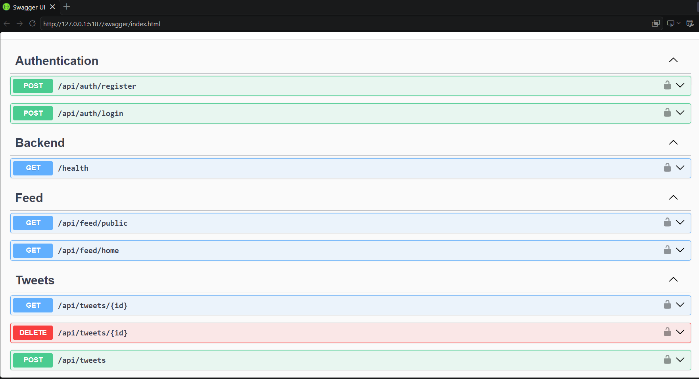
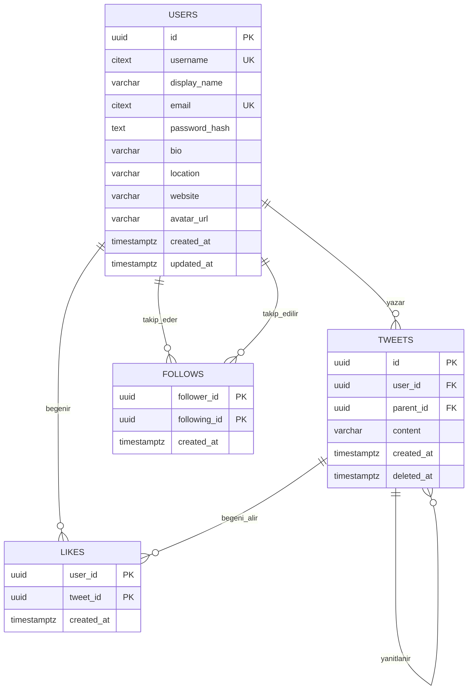

# YAPAY ZEKA DESTEKLİ YAZILIM GELİŞTİRME

**Ders:** Yapay Zeka Destekli Yazılım Geliştirme

**Takım:** Mavi Takım

## 👥 Mavi Takım Üyeleri

| Üye | Sorumluluk Alanı |
|-----|------------------|
| İpek Hellaçoğlu | Backend Entegrasyon|
| Ahmet Yasin Geldi | Database |
| Ceren Naz Dervişoğlu | Backend Api|
| Yusuf Ali Başer | Test |
| Yunus Emre Bulut | Frontend |

---

## 🎯 Genel Bakış

Mavi Takım'ın ürünü; kullanıcıların kısa mesaj paylaşabildiği, birbirini takip edebildiği ve
kişiselleştirilmiş bir zaman tünelinde içerik görebildiği bir Twitter klonudur.

---

## 🛠 Kullanılan Teknolojiler

| Katman | Teknoloji |
|--------|-----------|
| Ön yüz (Frontend) | JavaScript |
| Arka yüz (Backend) | C# / ASP.NET Core 8 Minimal API |
| Veritabanı | Supabase PostgreSQL |
| ORM / PostgreSQL sürücüsü | EF Core / Npgsql |
| Kimlik doğrulama | JWT |
| Kod kalitesi | SonarQube |
| Versiyon kontrol | Git & GitHub |
| Mimari| Asp.Net |

---

## 🤖 Yapay Zeka Kullanımı

Yapay zeka bu projede **geliştirme aracı** olarak kullanılmıştır.

| Araç | Kullanım amacı | Projedeki örnek |
|------|----------------|-----------------|
| GitHub Copilot (Copilot SDK, VS Code) | Kod geliştirme, hata ayıklama ve dokümantasyon | ASP.NET Core backend'in oluşturulması, derleme hatalarının giderilmesi ve çalıştırma/API yönergelerinin hazırlanması |
| Claude | Kod yazımı, hata ayıklama, test üretimi, dokümantasyon, birim testleri| Teknik planlama, veri tabanı |


---

## 🚀 Backend

Backend, ASP.NET Core 8 Minimal API ile modüler bir klasör yapısında geliştirilmiştir:

```text
Backend/
├── Contracts/   # İstek ve yanıt DTO'ları
├── Data/        # EF Core DbContext ve PostgreSQL eşlemeleri
├── Endpoints/   # Authentication, kullanıcı, tweet ve akış uçları
├── Models/      # User, Tweet, Like ve Follow varlıkları
├── Services/    # JWT, ortak API yardımcıları ve cursor sayfalama
├── Program.cs   # DI, JWT, CORS, hata yönetimi ve endpoint kaydı
└── appsettings.json
```


### Modüller ve Sorumluluklar

| Modül | Görev |
|-------|------------|
| Authentication | Kayıt/giriş, BCrypt parola hash'leme ve JWT üretimi |
| Users | Profil görüntüleme/güncelleme, tweet listesi ve takip ilişkileri |
| Tweets | Tweet/yanıt oluşturma, görüntüleme ve sahibinin soft delete işlemi |
| Feed | Genel akış ve takip edilen kullanıcıların akışı |
| Likes | Tweet beğenme ve beğeniyi kaldırma |

EF Core, Npgsql üzerinden Supabase PostgreSQL'e bağlanır. `UseSnakeCaseNamingConvention()` ve `citext` eşlemeleri mevcut veritabanı şemasına uyum sağlar. Tablolar [`database/schema.sql`](database/schema.sql) ile yönetilir; backend migration çalıştırmaz veya otomatik tablo oluşturmaz. Akışlar `(created_at, id)` cursor sıralamasıyla 20 kayıtlık sayfalar döndürür.

### Backend'i Çalıştırma

Gereksinimler: **.NET 8 SDK**, Supabase PostgreSQL bağlantısı ve önceden uygulanmış veritabanı şeması. Önce Supabase SQL Editor'de [`database/schema.sql`](database/schema.sql) dosyasını çalıştırın. PowerShell'de depo kök klasöründen:

```powershell
dotnet restore Backend\Backend.csproj
dotnet user-secrets --project Backend\Backend.csproj set "ConnectionStrings:Default" "Host=<session-pooler-host>;Port=5432;Database=postgres;Username=postgres.<project-ref>;Password=<database-password>;SSL Mode=Require;Trust Server Certificate=true;Maximum Pool Size=3"
dotnet user-secrets --project Backend\Backend.csproj set "Jwt:Secret" "<en-az-32-bayt-uzunlugunda-rastgele-bir-sir>"
dotnet run --project Backend\Backend.csproj
```

Bağlantı değerlerini Supabase **Session pooler** ayarlarından alın; `<...>` alanlarını gerçek değerlerle değiştirin. Gerçek veritabanı şifresini veya JWT sırrını kaynak koduna, `appsettings.json` dosyasına ya da GitHub'a eklemeyin. Başlatma tamamlandığında terminalde gösterilen `/swagger` adresini açın. API uçları, istek biçimleri ve güvenlik ayrıntıları için [`docs/backend.md`](docs/backend.md) dosyasına bakın.

---

## 🗄 Veri Tabanı

Veritabanı Supabase üzerinde PostgreSQL'dir. Şemanın tek kaynağı `database/schema.sql` dosyasıdır.
EF Core tablo oluşturmaz (migration kullanılmaz), yalnızca mevcut tablolara eşlenir.
Diyagram kaynağı: `database/schema.dbml` ([dbdiagram.io](https://dbdiagram.io) ile açılır).



| Tablo | İçerik | Kurallar |
|-------|--------|----------|
| `users` | Kullanıcılar | Kullanıcı adı 3-15 karakter (`a-z`, `0-9`, `_`), kullanıcı adı ve e-posta büyük/küçük harf duyarsız benzersiz, şifre BCrypt hash olarak saklanır |
| `tweets` | Tweetler ve yanıtlar | `parent_id` doluysa kayıt yanıttır, yanıta da yanıt verilebilir. İçerik 1-280 karakter |
| `likes` | Beğeniler | `(user_id, tweet_id)` birincil anahtar: aynı tweet iki kez beğenilemez |
| `follows` | Takip ilişkileri | `(follower_id, following_id)` birincil anahtar, kişi kendini takip edemez |

**Tasarım kararları**

- **Kimlikler UUID:** Tahmin edilemez, C# `Guid` tipine birebir karşılık gelir.
- **Soft delete:** Silinen tweetin `deleted_at` alanı dolar ve içeriği silinir (`NULL`). Satır kalır, böylece başkalarının yazdığı yanıtlar kaybolmaz.
- **Akış: fan-out on read.** Akış, istek anında takip edilenlerin tweetlerinden tek sorguyla üretilir. Bu ölçekte doğru indekslerle yeterince hızlıdır ve ek tablo gerektirmez. Takipçi sayıları çok büyüdüğünde, tweetin takipçilerin zaman tüneline yazıldığı fan-out on write yaklaşımına geçilebilir.
- **Sayaçlar saklanmaz:** Beğeni, yanıt ve takipçi sayıları `COUNT` ile hesaplanır. Her zaman doğrudur ve indeksler sayesinde hızlıdır.
- **Cursor tabanlı sayfalama:** Akışlar `(created_at, id)` çiftine göre 20'şerli gelir. Yeni tweet geldiğinde kayma olmaz, derin sayfalarda hız düşmez.
- **Kurallar iki katmanda:** Kurallar API'de doğrulanır, veritabanında da `CHECK`, `UNIQUE` ve yabancı anahtar kısıtlarıyla korunur.
- **Güvenlik:** Tüm tablolarda RLS açıktır ve politika tanımlı değildir. Bu yüzden Supabase'in otomatik REST API'si verilere erişemez. Veriye yalnızca backend erişir.

**İndeksler:** genel akış `tweets(created_at, id)` (yalnızca silinmemişler), profil ve takip akışı `tweets(user_id, created_at, id)`,
yanıtlar `tweets(parent_id, created_at)`, beğeni sayısı `likes(tweet_id)`, takipçi sayısı `follows(following_id)`.


---
