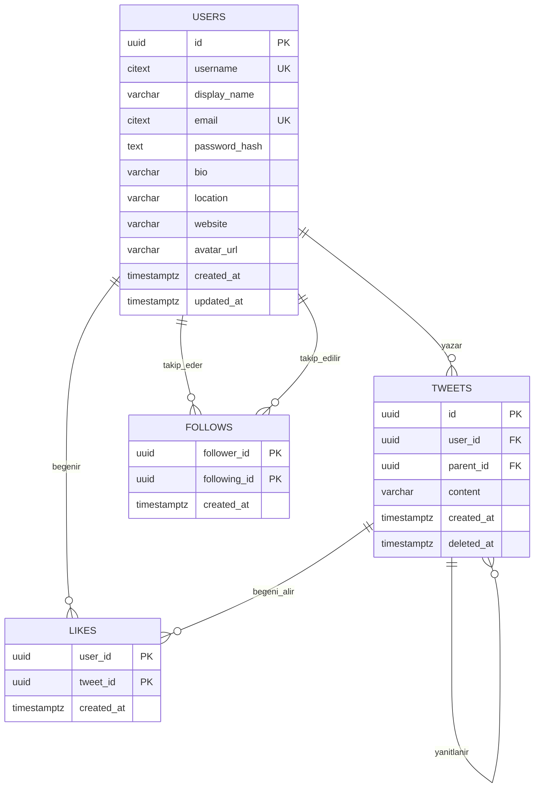

# YAPAY ZEKA DESTEKLİ YAZILIM GELİŞTİRME

**Ders:** Yapay Zeka Destekli Yazılım Geliştirme
**Takım:** Mavi Takım

## 👥 Mavi Takım Üyeleri

| Üye | Sorumluluk Alanı |
|-----|------------------|
| İpek Hellaçoğlu | Backend |
| Ahmet Yasin Geldi | Database |
| Ceren Naz Dervişoğlu | Backend |
| Yusuf Ali Başer | Test |
| Yunus Emre Bulut | Frontend |

---

## 🎯 Genel Bakış

---

## 🛠 Kullanılan Teknolojiler

| Katman | Teknoloji |
|--------|-----------|
| Ön yüz (Frontend) | JavaScript |
| Arka yüz (Backend) | C#|
| Veritabanı | Supabase |
| Kod kalitesi | SonarQube |
| Versiyon kontrol | Git & GitHub |
| Mimari| Asp.Net |

---

## 🤖 Yapay Zeka Kullanımı

Bu projede yapay zeka aracı **[ürünün geliştirilmesinde araç olarak / ürün içine entegrasyon olarak]** kullanılmıştır.

### Geliştirme sürecinde kullanılan araçlar

| Araç | Ne için kullanıldı? | Örnek |
|------|---------------------|-------|
| Claude | Kod yazımı, hata ayıklama, test üretimi, dokümantasyon, birim testleri|

## 🗄 Veri Modeli

Veritabanı Supabase üzerinde PostgreSQL'dir. Şemanın tek kaynağı `database/schema.sql` dosyasıdır.
EF Core tablo oluşturmaz (migration kullanılmaz), yalnızca mevcut tablolara eşlenir.
Diyagram kaynağı: `database/schema.dbml` ([dbdiagram.io](https://dbdiagram.io) ile açılır).

| Tablo | İçerik | Kurallar |
|-------|--------|----------|
| `users` | Kullanıcılar | Kullanıcı adı 3-15 karakter (`a-z`, `0-9`, `_`), kullanıcı adı ve e-posta büyük/küçük harf duyarsız benzersiz, şifre BCrypt hash olarak saklanır |
| `tweets` | Tweetler ve yanıtlar | `parent_id` doluysa kayıt yanıttır, yanıta da yanıt verilebilir. İçerik 1-280 karakter |
| `likes` | Beğeniler | `(user_id, tweet_id)` birincil anahtar: aynı tweet iki kez beğenilemez |
| `follows` | Takip ilişkileri | `(follower_id, following_id)` birincil anahtar, kişi kendini takip edemez |

**Tasarım kararları**

- **Kimlikler UUID:** Tahmin edilemez, C# `Guid` tipine birebir karşılık gelir.
- **Soft delete:** Silinen tweetin `deleted_at` alanı dolar ve içeriği silinir (`NULL`). Satır kalır, böylece başkalarının yazdığı yanıtlar kaybolmaz.
- **Akış: fan-out on read.** Akış, istek anında takip edilenlerin tweetlerinden tek sorguyla üretilir. Bu ölçekte doğru indekslerle yeterince hızlıdır ve ek tablo gerektirmez. Takipçi sayıları çok büyüdüğünde, tweetin takipçilerin zaman tüneline yazıldığı fan-out on write yaklaşımına geçilebilir.
- **Sayaçlar saklanmaz:** Beğeni, yanıt ve takipçi sayıları `COUNT` ile hesaplanır. Her zaman doğrudur ve indeksler sayesinde hızlıdır.
- **Cursor tabanlı sayfalama:** Akışlar `(created_at, id)` çiftine göre 20'şerli gelir. Yeni tweet geldiğinde kayma olmaz, derin sayfalarda hız düşmez.
- **Kurallar iki katmanda:** Kurallar API'de doğrulanır, veritabanında da `CHECK`, `UNIQUE` ve yabancı anahtar kısıtlarıyla korunur.
- **Güvenlik:** Tüm tablolarda RLS açıktır ve politika tanımlı değildir. Bu yüzden Supabase'in otomatik REST API'si verilere erişemez. Veriye yalnızca backend erişir.

**İndeksler:** genel akış `tweets(created_at, id)` (yalnızca silinmemişler), profil ve takip akışı `tweets(user_id, created_at, id)`,
yanıtlar `tweets(parent_id, created_at)`, beğeni sayısı `likes(tweet_id)`, takipçi sayısı `follows(following_id)`.

---
